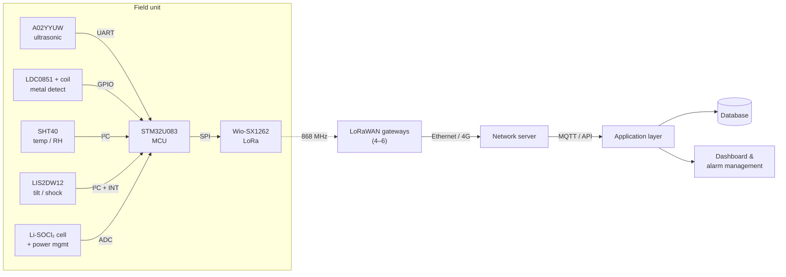

# STM32 LoRaWAN Smart Fill-Level & Metal Detection Sensor Node

**Low-power IoT bin monitoring with STM32U083, SX1262 LoRa, ultrasonic level sensing and inductive metal detection.**

[](https://github.com/USERNAME/stm32-lorawan-smart-fill-monitoring/actions/workflows/ci.yml)


🇹🇷 [Türkçe](README.tr.md)

A low-power, camera-free monitoring system concept for **~2,000 battery-powered
field units** (bins / containers). Each unit measures fill level, detects metal
content, watches for tilt, impact and heat, and reports to a central platform
**every 30 minutes over LoRaWAN**, from about **20 km** away.

The repository contains the system design, a **unit-tested C implementation of
the on-device decision logic**, a compact **11-byte binary payload** with a
ready-to-use network-server decoder, and an **energy budget model**.

> **Status:** concept / pre-prototype. Hardware is specified, not yet built.
> The firmware logic is hardware-independent and runs on any C99 compiler.

---

## Highlights

- **Edge processing.** Median filtering, confidence checks and alarm decisions run on the node; only an 11-byte summary goes on air.
- **No false alarms from a single bad echo.** Low-confidence readings cannot raise or clear fill alarms, and fill alarms use hysteresis.
- **Event-driven priority uplinks.** Critical fill, tilt and heat alarms are sent immediately, but only when newly raised.
- **Decade-scale battery life (estimated).** ~22 µA average at SF9; energy is not the limiting factor, cell ageing is.
- **~$61–67 per field unit** at concept-stage pricing.

## System architecture



| Function | Part |
|---|---|
| Fill level | DFRobot A02YYUW ultrasonic (IP67, 3–450 cm) |
| Metal detection | TI LDC0851 inductive switch + PCB coil |
| Temperature / humidity | Sensirion SHT40 |
| Tilt / shock | ST LIS2DW12 accelerometer |
| MCU | ST STM32U083KCU6 (Cortex-M0+, ultra-low power) |
| Radio | Seeed Wio-SX1262 (Semtech SX1262), EU868 |
| Power | 3.6 V Li-SOCl₂ primary cell + buffer capacitor |

Full BOM with costs: [hardware/BOM.md](hardware/BOM.md)

## Decision logic

Each cycle the node takes several ultrasonic samples, rejects out-of-range
values, takes the median and computes:

```
Fill (%) = 100 × (D_empty − D_measured) / (D_empty − D_full)
```

| Condition | Result |
|---|---|
| Fill ≥ 90 % / ≥ 95 % | `HIGH_FILL` / `CRITICAL_FILL` (5-point hysteresis) |
| Rapid rise between cycles | `FAST_FILL` |
| Too few valid samples / samples scattered | `SENSOR_FAULT` / `LOW_CONFIDENCE` |
| LDC0851 output | `METAL` / `NON_METAL` / `UNKNOWN` |
| Accelerometer interrupt | `TILT` / `SHOCK` |
| ≥ 60 °C, low battery | `TEMP_ANOMALY`, `LOW_BATTERY` |

Details and flow chart: [docs/en/technical-concept.md](docs/en/technical-concept.md#3-sensor-processing-and-decision-logic)

## Uplink payload (11 bytes)

| Byte | 0 | 1 | 2–3 | 4–5 | 6 | 7–8 | 9–10 |
|---|---|---|---|---|---|---|---|
| Field | version · priority · material | fill % | alarm mask | temp (0.1 °C) | RH % | battery mV | distance mm |

```
11 57 0001 011A 2D 0DFC 0200  →  87 % full, METAL, HIGH_FILL, 28.2 °C, 45 %RH, 3.58 V
```

Specification: [payload/PAYLOAD_FORMAT.md](payload/PAYLOAD_FORMAT.md) ·
Decoder for The Things Stack / ChirpStack: [payload/decoder.js](payload/decoder.js)

## Quick start

Requirements: a C99 compiler and `make`; Node.js and Python 3 for the extras.

```bash
# Firmware logic: build and run unit tests
cd firmware && make test

# Payload decoder tests
node payload/test/decoder.test.js

# Energy budget (try --sf 12, --battery-mah 8500)
python3 tools/energy_budget.py --sf 9
```

## Repository structure

```
├── docs/
│   ├── en/technical-concept.md     Full technical concept (English)
│   ├── tr/teknik-konsept.md        Full technical concept (Turkish)
│   ├── tr/teknik-konsept-raporu.pdf Original report (PDF, Turkish)
│   └── images/                     Block diagram
├── firmware/
│   ├── include/fill_logic.h        Public API
│   ├── src/fill_logic.c            Filtering, decision logic, payload encoder
│   ├── test/test_fill_logic.c      Unit tests (no framework needed)
│   └── Makefile
├── payload/
│   ├── PAYLOAD_FORMAT.md           Byte-level uplink specification
│   ├── decoder.js                  TTS / ChirpStack payload formatter
│   └── test/decoder.test.js
├── hardware/BOM.md                 Bill of materials and cost
└── tools/energy_budget.py          Airtime and battery life estimator
```

## Key numbers

| | |
|---|---|
| Field units | ~2,000 |
| Reporting interval | 30 min (96,000 uplinks/day) |
| Uplink size | 11 bytes (24 bytes on air incl. LoRaWAN header) |
| Time on air | 62 ms (SF7) – 1.48 s (SF12) |
| Gateways | 4–6 (to be confirmed by RF survey) |
| Unit cost (est.) | ~$61–67 |
| Total hardware (est.) | ~$124k–138k incl. gateways |

## Roadmap

- [x] System concept, part selection and cost estimate
- [x] Hardware-independent decision logic with unit tests
- [x] Binary payload format and network-server decoder
- [x] Energy budget model
- [ ] Sensor drivers and LoRaWAN stack integration on STM32U083
- [ ] Prototype PCB (2-layer) and enclosure
- [ ] Current-consumption measurements to replace the energy-model assumptions
- [ ] Field pilot: threshold calibration, RF survey, final gateway count

## License

Released under the [MIT License](LICENSE).
