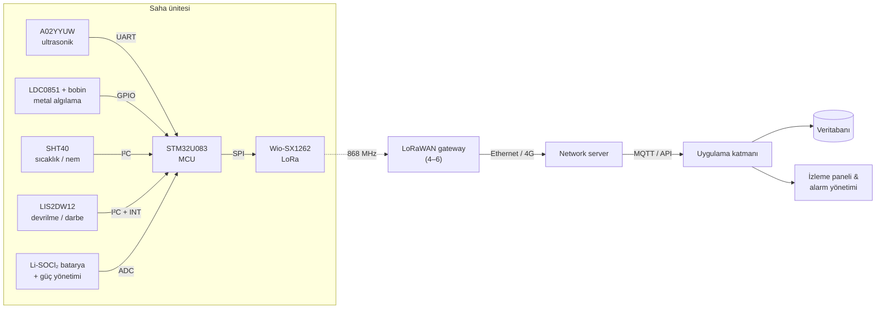

# STM32 ve LoRaWAN Tabanlı Akıllı Doluluk ve Metal Algılama Sensör Ünitesi

**STM32U083, SX1262 LoRa, ultrasonik seviye ölçümü ve endüktif metal algılama ile düşük güçlü IoT konteyner izleme.**


🇬🇧 [English](README.md)

Bataryayla çalışan **~2.000 saha ünitesi** (konteyner / hazne) için düşük güçlü,
kamerasız bir izleme sistemi konsepti. Her ünite doluluk seviyesini ölçer, metal
içeriği algılar, devrilme, darbe ve aşırı ısıyı izler ve yaklaşık **20 km**
uzaklıktaki merkezi platforma **30 dakikada bir LoRaWAN üzerinden** rapor verir.

Repoda sistem tasarımı, **cihaz üzerindeki karar mantığının birim testli C
uygulaması**, ağ sunucusunda doğrudan kullanılabilecek decoder'ı ile birlikte
**11 byte'lık binary paket formatı** ve bir **enerji bütçesi modeli** bulunur.

> **Durum:** konsept / prototip öncesi. Donanım tanımlandı, henüz üretilmedi.
> Firmware mantığı donanımdan bağımsızdır ve her C99 derleyicisinde çalışır.

---

## Öne çıkanlar

- **Uçta işleme.** Medyan filtre, güven kontrolü ve alarm kararları cihazda çalışır; havaya yalnızca 11 byte'lık özet çıkar.
- **Tek hatalı yankı alarm üretmez.** Düşük güvenli ölçümler doluluk alarmını tetikleyemez ya da kaldıramaz; doluluk alarmları histerezislidir.
- **Olay tabanlı öncelikli gönderim.** Kritik doluluk, devrilme ve ısı alarmları hemen gönderilir, ama yalnızca ilk oluştuklarında.
- **On yıl ölçeğinde batarya ömrü (tahmini).** SF9'da ortalama ~22 µA; sınırlayıcı faktör enerji değil, hücre yaşlanmasıdır.
- Konsept aşaması fiyatlarıyla **saha ünitesi başına ~$61–67**.

## Sistem mimarisi



| İşlev | Parça |
|---|---|
| Doluluk | DFRobot A02YYUW ultrasonik (IP67, 3–450 cm) |
| Metal algılama | TI LDC0851 endüktif anahtar + PCB bobin |
| Sıcaklık / nem | Sensirion SHT40 |
| Devrilme / darbe | ST LIS2DW12 ivmeölçer |
| MCU | ST STM32U083KCU6 (Cortex-M0+, ultra düşük güç) |
| Radyo | Seeed Wio-SX1262 (Semtech SX1262), EU868 |
| Güç | 3,6 V Li-SOCl₂ primer batarya + tampon kapasitör |

Maliyetli tam BOM: [hardware/BOM.md](hardware/BOM.md)

## Karar mantığı

Her döngüde birden fazla ultrasonik örnek alınır, aralık dışı değerler elenir,
medyan alınır ve doluluk hesaplanır:

```
Doluluk (%) = 100 × (D_boş − D_ölçülen) / (D_boş − D_dolu)
```

| Durum | Sonuç |
|---|---|
| Doluluk ≥ %90 / ≥ %95 | `HIGH_FILL` / `CRITICAL_FILL` (5 puan histerezis) |
| Döngüler arası hızlı artış | `FAST_FILL` |
| Yetersiz geçerli örnek / dağınık örnekler | `SENSOR_FAULT` / `LOW_CONFIDENCE` |
| LDC0851 çıkışı | `METAL` / `NON_METAL` / `UNKNOWN` |
| İvmeölçer kesmesi | `TILT` / `SHOCK` |
| ≥ 60 °C, düşük batarya | `TEMP_ANOMALY`, `LOW_BATTERY` |

Ayrıntılar ve akış şeması: [docs/tr/teknik-konsept.md](docs/tr/teknik-konsept.md)

## Uplink paketi (11 byte)

| Byte | 0 | 1 | 2–3 | 4–5 | 6 | 7–8 | 9–10 |
|---|---|---|---|---|---|---|---|
| Alan | sürüm · öncelik · içerik | doluluk % | alarm maskesi | sıcaklık (0,1 °C) | nem % | batarya mV | mesafe mm |

```
11 57 0001 011A 2D 0DFC 0200  →  %87 dolu, METAL, HIGH_FILL, 28,2 °C, %45 nem, 3,58 V
```

Format tanımı: [payload/PAYLOAD_FORMAT.md](payload/PAYLOAD_FORMAT.md) ·
The Things Stack / ChirpStack decoder'ı: [payload/decoder.js](payload/decoder.js)

## Hızlı başlangıç

Gereksinimler: C99 derleyici ve `make`; ek araçlar için Node.js ve Python 3.

```bash
# Firmware mantığı: derle ve birim testlerini çalıştır
cd firmware && make test

# Payload decoder testleri
node payload/test/decoder.test.js

# Enerji bütçesi (--sf 12, --battery-mah 8500 deneyin)
python3 tools/energy_budget.py --sf 9
```

## Repo yapısı

```
├── docs/
│   ├── en/technical-concept.md      Teknik konsept (İngilizce)
│   ├── tr/teknik-konsept.md         Teknik konsept (Türkçe)
│   ├── tr/teknik-konsept-raporu.pdf Orijinal rapor (PDF)
│   └── images/                      Blok diyagram
├── firmware/
│   ├── include/fill_logic.h         Genel API
│   ├── src/fill_logic.c             Filtreleme, karar mantığı, paket kodlayıcı
│   ├── test/test_fill_logic.c       Birim testleri (framework gerekmez)
│   └── Makefile
├── payload/
│   ├── PAYLOAD_FORMAT.md            Byte seviyesinde paket tanımı
│   ├── decoder.js                   TTS / ChirpStack payload formatter
│   └── test/decoder.test.js
├── hardware/BOM.md                  Malzeme listesi ve maliyet
└── tools/energy_budget.py           İletim süresi ve batarya ömrü hesabı
```

## Temel değerler

| | |
|---|---|
| Saha ünitesi | ~2.000 |
| Raporlama aralığı | 30 dk (günde 96.000 uplink) |
| Paket boyutu | 11 byte (LoRaWAN başlığıyla havada 24 byte) |
| İletim süresi | 62 ms (SF7) – 1,48 s (SF12) |
| Gateway | 4–6 (RF saha ölçümüyle kesinleşecek) |
| Birim maliyet (tahmini) | ~$61–67 |
| Toplam donanım (tahmini) | gateway'ler dahil ~$124k–138k |

## Yol haritası

- [x] Sistem konsepti, parça seçimi ve maliyet tahmini
- [x] Donanımdan bağımsız, birim testli karar mantığı
- [x] Binary paket formatı ve ağ sunucusu decoder'ı
- [x] Enerji bütçesi modeli
- [ ] STM32U083 üzerinde sensör sürücüleri ve LoRaWAN stack entegrasyonu
- [ ] Prototip PCB (2 katman) ve muhafaza
- [ ] Enerji modelindeki varsayımların akım ölçümleriyle güncellenmesi
- [ ] Saha pilotu: eşik kalibrasyonu, RF ölçümü, nihai gateway sayısı

## Lisans

[MIT Lisansı](LICENSE) ile yayınlanmıştır.
