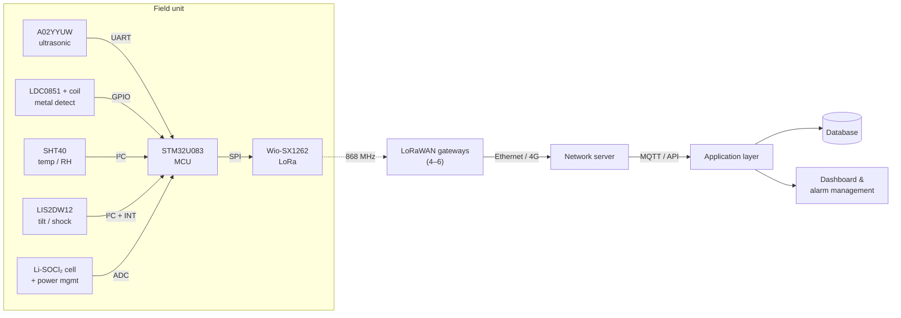
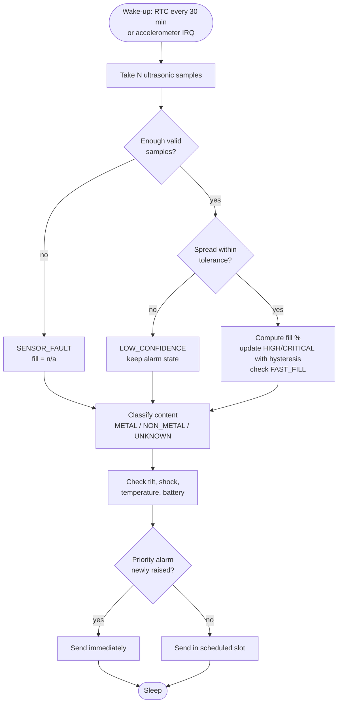

# STM32 LoRaWAN Smart Fill-Level & Metal Detection Sensor Node — Technical Concept

**Author:** Ömer Faruk Yesir · 🇹🇷 [Türkçe sürüm](../tr/teknik-konsept.md)

## 1. Scope and design summary

The goal is a low-power, scalable system that lets roughly **2,000 field units**
be monitored centrally **without cameras**: fill level, basic content
properties, abnormal events and device health. Each unit reports every
**30 minutes** to a central system about **20 km** away.

The guiding criteria are simplicity, low cost, low power and long unattended
field life. Fill level, content and device state are sensed with separate
physical measurements; the data is processed on the node and only summaries and
alarms are transmitted. The central system tracks fill, content, connectivity
and health per device, detects overflow and anomalies, and supports more
efficient field operations.

## 2. Field unit hardware and architecture

Components were chosen by weighing technical fit, power consumption, unit cost
and availability at 2,000-unit volume. The node spends almost all its time in a
low-power mode, waking only to measure and transmit. The full part list with
cost is in [hardware/BOM.md](../../hardware/BOM.md).

| Function | Part | Rationale |
|----------|------|-----------|
| Fill level (ultrasonic) | DFRobot A02YYUW | IP67, 3–450 cm range for a ~2.5 m container, simple integration |
| Metal detection (inductive) | TI LDC0851 + PCB coil | Sufficient for metal / non-metal, 3.3 V, very low power and cost |
| Temperature / humidity | Sensirion SHT40 | Compensation and heat anomaly monitoring, compact, low power |
| Tilt / shock | ST LIS2DW12 | Low-power modes and interrupts detect events without keeping the MCU awake |
| MCU | ST STM32U083KCU6 | Enough resources for sensing, processing and LoRaWAN; ultra-low power |
| Radio | Seeed Wio-SX1262 (Semtech SX1262) | EU868 LoRaWAN; a ready RF module cuts development time and RF risk |
| Power | 3.6 V Li-SOCl₂ + low-Iq regulator + buffer capacitor | Low self-discharge, high energy density; capacitor covers TX current peaks |

All parts share one low-voltage power domain. Sensors connect directly to MCU
peripherals while the radio is a separate module, so sensing and communication
layers can be developed independently.

### 2.1 System architecture



The original block diagram from the report is in
[`docs/images/system-architecture-tr.png`](../images/system-architecture-tr.png).

## 3. Sensor processing and decision logic

Raw sensor data is never sent to the centre. The MCU filters measurements and
derives fill level, content class, alarms and health locally, which reduces
traffic and energy use and keeps field calibration manageable.

The logic is implemented as a hardware-independent, unit-tested C module:
[`firmware/src/fill_logic.c`](../../firmware/src/fill_logic.c).

### 3.1 Fill level and filtering

Several distance samples are taken per cycle. Samples outside the sensor's
physical range are discarded and the **median** of the rest is used, which
suppresses irregular material surfaces and spurious echoes. Fill is computed
from per-container calibration distances stored at installation:

$$
\text{Fill}(\%) = 100 \times \frac{D_\text{empty} - D_\text{measured}}{D_\text{empty} - D_\text{full}}
$$

- Fewer than the minimum number of valid samples → `SENSOR_FAULT`, fill reported as unavailable.
- Valid samples spread wider than the tolerance → `LOW_CONFIDENCE`.
  A low-confidence reading **can neither raise nor clear** a fill alarm and does
  not update the fast-fill baseline, so a single bad echo never causes an alarm.
  Persistent low confidence also points to sensor contamination or reflections.

### 3.2 Content classification and anomaly checks

The LDC0851 output drives the content decision: `METAL`, `NON_METAL`, or
`UNKNOWN` when the reading is unreliable, the distance is invalid, or the
container is effectively empty (nothing to classify).

| Input / condition | Result |
|---|---|
| Metal detected, valid reading | `METAL` |
| No metal, valid reading | `NON_METAL` |
| Fill ≥ 90 % / ≥ 95 % | `HIGH_FILL` / `CRITICAL_FILL` (5-point hysteresis) |
| Rapid rise between two cycles | `FAST_FILL` |
| LIS2DW12 tilt or impact interrupt | `TILT` / `SHOCK` |
| Temperature ≥ 60 °C | `TEMP_ANOMALY` (possible fire / heat source) |
| Low battery, sensor fault | `LOW_BATTERY`, `SENSOR_FAULT` |

### 3.3 Decision flow



Priority uplinks are sent only on the **rising edge** of `CRITICAL_FILL`,
`TILT` or `TEMP_ANOMALY`, so a container that stays full does not keep
generating urgent messages. Thresholds and filter parameters are defaults to be
calibrated with field data during the prototype phase.

## 4. Communication, power and cost

### 4.1 Communication and scalability

LoRaWAN **Class A / EU868** is used. 2,000 devices reporting every 30 minutes
produce **96,000 uplinks/day**. The 20 km distance is not covered by a direct
node-to-centre link but by the chain:

```
Field unit → LoRaWAN gateway → Ethernet/4G → Network server → MQTT/API → Database / alarm dashboard
```

Collisions are reduced with a compact binary payload, ADR and randomised
transmit offsets. Four gateways are planned initially; the final count (4–6)
will be set by RF site measurements.

The uplink is a fixed **11-byte binary payload**
([specification](../../payload/PAYLOAD_FORMAT.md)) instead of text/JSON. Even at
SF12 the time on air is ~1.5 s, i.e. ~0.08 % of the EU868 1 % duty-cycle
budget.

### 4.2 Power and PCB approach

The node runs from a 3.6 V Li-SOCl₂ primary cell. The MCU stays in a low-power
mode outside measurement and transmission; sensors are powered only while
measuring; short LoRa TX peaks are supplied by a low-ESR buffer capacitor
(Li-SOCl₂ cells cannot deliver high pulse currents on their own).

Because a ready SX1262 module is used, a **2-layer PCB** is sufficient. Power,
sensor/digital and RF sections are separated in layout; ESD protection and
SWD test/programming points are provided.

### 4.3 Energy budget (estimate)

[`tools/energy_budget.py`](../../tools/energy_budget.py) estimates consumption
from datasheet-typical currents. All inputs are assumptions to be replaced by
prototype measurements.

| Scenario | Time on air | Load | Estimated life (17 Ah D-cell, 70 % usable, 1 %/yr self-discharge) |
|---|---:|---:|---:|
| SF9 (typical) | 206 ms | ~0.54 mAh/day | > 10 years |
| SF12 (coverage edge) | 1483 ms | ~1.30 mAh/day | > 10 years |
| SF12, 8.5 Ah C-cell | 1483 ms | ~1.30 mAh/day | ~10.6 years |

**Takeaway:** energy is not the limiting factor; cell ageing is. This opens the
option of a smaller, cheaper cell after measurements confirm the sleep current.

### 4.4 Cost

| Item | Estimate |
|---|---:|
| Field unit | ~$61–67 |
| 2,000 field units | ~$122k–134k |
| 4–6 LoRaWAN gateways | ~$2k–4k |

Breakdown and cost-reduction levers: [hardware/BOM.md](../../hardware/BOM.md).

## 5. Extensibility

The design is modular. The first version focuses on fill level, metal /
non-metal separation and basic health monitoring. Finer content classification
can be added with a capacitive/dielectric or optical sensor while keeping the
MCU and communication architecture. Environmental sensors can be dropped to cut
cost; gateways can be added for coverage, or cellular (NB-IoT / LTE-M)
evaluated for isolated sites. The final configuration will be optimised with
pilot data for accuracy, cost and maintenance effort.

## 6. Limitations and open points

- Ultrasonic measurement assumes a reasonably reflective surface; foam, very
  soft or strongly sloped material piles may need a different mounting angle or
  sensor.
- Inductive sensing only detects metal near the coil; it indicates presence,
  not the proportion of metal in the load.
- Gateway count, ADR behaviour and real battery life require a field pilot.
