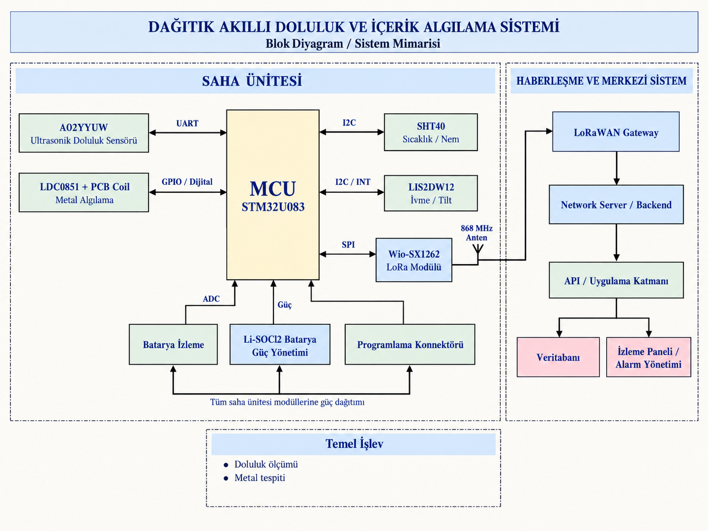
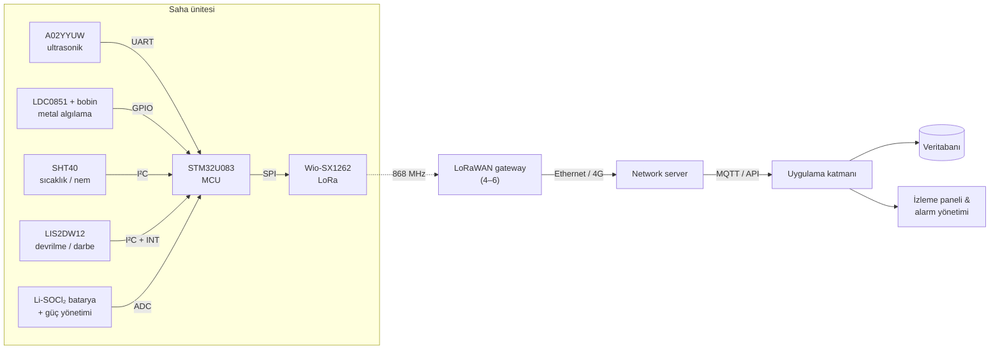
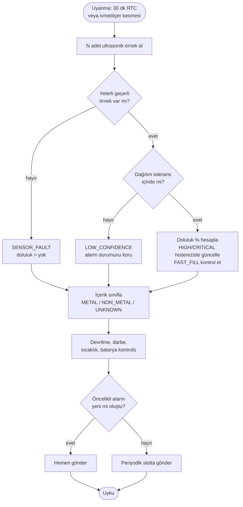

# STM32 ve LoRaWAN Tabanlı Akıllı Doluluk ve Metal Algılama Sensör Ünitesi — Teknik Konsept

**Hazırlayan:** Ömer Faruk Yesir · 🇬🇧 [English version](../en/technical-concept.md) · 📄 [PDF rapor](teknik-konsept-raporu.pdf)

## 1. Sistem kapsamı ve tasarım özeti

Amaç, yaklaşık **2.000 saha ünitesinin** doluluk seviyesinin, temel içerik
özelliklerinin, olağandışı durumlarının ve cihaz sağlığının **kamera
kullanılmadan** merkezi olarak izlenebildiği, düşük güç tüketimli ve
ölçeklenebilir bir sistem tasarlamaktır. Her ünite verisini **30 dakikada bir**,
yaklaşık **20 km** uzaklıktaki merkezi sisteme iletir.

Temel tasarım kriterleri sadelik, düşük maliyet, düşük güç tüketimi ve sahada
uzun süre bakımsız çalışabilmedir. Doluluk, içerik ve cihaz durumu farklı
fiziksel ölçümlerle algılanır; veriler saha ünitesinde işlenir ve merkeze
yalnızca özet bilgiler ve alarmlar gönderilir. Merkezi sistem her cihazın
doluluk, içerik, haberleşme ve sağlık durumunu izler, aşırı doluluk ve
anomalileri tespit eder ve saha operasyonlarının daha verimli planlanmasını
sağlar.

## 2. Saha ünitesi donanımı ve mimari

Bileşenler teknik yeterlilik, güç tüketimi, birim maliyet ve 2.000 adetlik
üretimde tedarik edilebilirlik birlikte değerlendirilerek seçilmiştir. Cihaz
zamanının neredeyse tamamını düşük güç modunda geçirir; yalnızca ölçüm ve
iletim için uyanır. Maliyetli tam parça listesi:
[hardware/BOM.md](../../hardware/BOM.md).

| İşlev | Parça | Seçim gerekçesi |
|-------|-------|-----------------|
| Doluluk (ultrasonik) | DFRobot A02YYUW | IP67, 3–450 cm menzil ~2,5 m hazne için yeterli, kolay entegrasyon |
| Metal algılama (endüktif) | TI LDC0851 + PCB bobin | Metal / metal dışı ayrımı için yeterli, 3,3 V, çok düşük güç ve maliyet |
| Sıcaklık / nem | Sensirion SHT40 | Kompanzasyon ve sıcaklık anomalisi izleme, kompakt ve düşük güçlü |
| Devrilme / darbe | ST LIS2DW12 | Düşük güç modları ve kesmelerle MCU'yu uyanık tutmadan olay algılama |
| MCU | ST STM32U083KCU6 | Ölçüm, işleme ve LoRaWAN için yeterli kaynak; ultra düşük güç |
| Radyo | Seeed Wio-SX1262 (Semtech SX1262) | EU868 LoRaWAN; hazır RF modülü geliştirme süresini ve RF riskini azaltır |
| Güç | 3,6 V Li-SOCl₂ + düşük Iq regülatör + tampon kapasitör | Düşük öz deşarj, yüksek enerji yoğunluğu; kapasitör TX akım darbelerini karşılar |

Tüm bileşenler tek bir düşük gerilim güç alanında çalışır. Sensörler doğrudan
MCU çevre birimlerine bağlanırken radyo ayrı bir modüldür; böylece algılama ve
haberleşme katmanları bağımsız geliştirilebilir.

### 2.1 Sistem mimarisi





## 3. Sensör verilerinin işlenmesi ve karar algoritması

Ham sensör verisi merkeze gönderilmez. MCU ölçümleri filtreler; doluluk, içerik
sınıfı, alarm ve sağlık bilgisini yerelde üretir. Böylece veri trafiği ve enerji
tüketimi azalır, saha kalibrasyonu yönetilebilir hale gelir.

Karar mantığı donanımdan bağımsız ve birim testli bir C modülü olarak
uygulanmıştır: [`firmware/src/fill_logic.c`](../../firmware/src/fill_logic.c).

### 3.1 Doluluk hesabı ve filtreleme

Her döngüde birden fazla mesafe örneği alınır. Sensörün fiziksel aralığı
dışındaki örnekler elenir ve kalanların **medyanı** kullanılır; bu, düzensiz
malzeme yüzeyinin ve anlık yanlış yankıların etkisini azaltır. Doluluk, kurulumda
her konteyner tipi için kalibre edilip cihaz belleğine yazılan referans
mesafelerle hesaplanır:

$$
\text{Doluluk}(\%) = 100 \times \frac{D_\text{boş} - D_\text{ölçülen}}{D_\text{boş} - D_\text{dolu}}
$$

- Geçerli örnek sayısı yetersizse → `SENSOR_FAULT`, doluluk "yok" olarak raporlanır.
- Geçerli örneklerin dağılımı toleransı aşarsa → `LOW_CONFIDENCE`.
  Düşük güvenli bir ölçüm doluluk alarmını **ne tetikleyebilir ne de
  kaldırabilir**, hızlı dolum referansını da güncellemez; böylece tek bir
  hatalı yankı alarm üretmez. Süreklilik gösteren düşük güven, sensör kirlenmesi
  veya hatalı yansımaya da işaret eder.

### 3.2 İçerik kararı ve anomali kontrolleri

İçerik kararı LDC0851 çıkışına dayanır: `METAL`, `NON_METAL` ya da ölçüm
güvenilir değilse, mesafe geçersizse veya konteyner fiilen boşsa (sınıflanacak
içerik yoksa) `UNKNOWN`.

| Girdi / durum | Sonuç |
|---|---|
| Metal algılandı, ölçüm geçerli | `METAL` |
| Metal yok, ölçüm geçerli | `NON_METAL` |
| Doluluk ≥ %90 / ≥ %95 | `HIGH_FILL` / `CRITICAL_FILL` (5 puan histerezis) |
| İki döngü arasında hızlı artış | `FAST_FILL` |
| LIS2DW12 eğim veya darbe kesmesi | `TILT` / `SHOCK` |
| Sıcaklık ≥ 60 °C | `TEMP_ANOMALY` (olası yangın / ısı kaynağı) |
| Düşük batarya, sensör hatası | `LOW_BATTERY`, `SENSOR_FAULT` |

### 3.3 Karar akışı



Öncelikli gönderim yalnızca `CRITICAL_FILL`, `TILT` veya `TEMP_ANOMALY`
alarmının **ilk oluştuğu anda** yapılır; dolu kalan bir konteyner sürekli acil
mesaj üretmez. Eşik ve filtre parametreleri varsayılan değerlerdir, prototip
aşamasında saha verisiyle kalibre edilecektir.

## 4. Haberleşme, güç ve maliyet

### 4.1 Haberleşme ve ölçeklenebilirlik

LoRaWAN **Class A / EU868** kullanılır. 2.000 cihazın 30 dakikada bir veri
göndermesi **günde 96.000 uplink** eder. 20 km mesafe doğrudan cihaz-merkez RF
bağlantısıyla değil, şu zincirle karşılanır:

```
Saha ünitesi → LoRaWAN gateway → Ethernet/4G → Network server → MQTT/API → Veritabanı / alarm paneli
```

Çakışmalar kompakt binary paket, ADR ve rastgele gönderim ofsetleriyle
azaltılır. Başlangıçta 4 gateway öngörülmüştür; nihai sayı (4–6) RF saha
ölçümleriyle belirlenecektir.

Uplink metin/JSON yerine sabit **11 byte'lık binary paket** olarak tanımlanmıştır
([format tanımı](../../payload/PAYLOAD_FORMAT.md)). SF12'de bile iletim süresi
~1,5 s'dir; bu, EU868 %1 görev döngüsü bütçesinin yalnızca ~%0,08'i kadardır.

### 4.2 Güç ve PCB yaklaşımı

Saha ünitesi 3,6 V Li-SOCl₂ primer batarya ile beslenir. MCU ölçüm ve iletim
dışında düşük güç modunda tutulur; sensörler yalnız ölçüm sırasında enerjilenir;
kısa LoRa TX akım darbeleri düşük ESR'li tampon kapasitörle karşılanır
(Li-SOCl₂ hücreler yüksek darbe akımını tek başına veremez).

Hazır SX1262 modülü kullanıldığı için **2 katmanlı PCB** yeterlidir. Güç,
sensör/dijital ve RF bölümleri yerleşimde ayrılır; ESD koruması ve SWD
test/programlama noktaları bırakılır.

### 4.3 Enerji bütçesi (tahmini)

[`tools/energy_budget.py`](../../tools/energy_budget.py) datasheet tipik
akımlarıyla tüketimi tahmin eder. Tüm girdiler varsayımdır; prototip
ölçümleriyle güncellenecektir.

| Senaryo | İletim süresi | Yük | Tahmini ömür (17 Ah D-hücre, %70 kullanılabilir, yıllık %1 öz deşarj) |
|---|---:|---:|---:|
| SF9 (tipik) | 206 ms | ~0,54 mAh/gün | > 10 yıl |
| SF12 (kapsama sınırı) | 1483 ms | ~1,30 mAh/gün | > 10 yıl |
| SF12, 8,5 Ah C-hücre | 1483 ms | ~1,30 mAh/gün | ~10,6 yıl |

**Sonuç:** Sınırlayıcı faktör enerji değil, hücre yaşlanmasıdır. Uyku akımı
ölçümle doğrulandıktan sonra daha küçük ve ucuz bir hücreye geçmek mümkündür.

### 4.4 Maliyet

| Kalem | Tahmin |
|---|---:|
| Saha ünitesi | ~$61–67 |
| 2.000 saha ünitesi | ~$122k–134k |
| 4–6 LoRaWAN gateway | ~$2k–4k |

Ayrıntılı döküm ve maliyet azaltma seçenekleri: [hardware/BOM.md](../../hardware/BOM.md).

## 5. Genişletilebilirlik

Tasarım modülerdir. İlk sürüm doluluk, metal / metal dışı ayrımı ve temel cihaz
sağlığı takibine odaklanır. Daha ayrıntılı içerik sınıflandırması gerekirse
MCU ve haberleşme mimarisi korunarak kapasitif/dielektrik veya optik sensör
eklenebilir. Bütçeye göre çevresel sensörler sadeleştirilebilir; kapsama için
gateway eklenebilir veya izole sahalarda hücresel haberleşme (NB-IoT / LTE-M)
değerlendirilebilir. Nihai yapı pilot verilerle doğruluk, maliyet ve bakım
ihtiyacı açısından optimize edilecektir.

## 6. Kısıtlar ve açık noktalar

- Ultrasonik ölçüm yeterince yansıtıcı bir yüzey varsayar; köpük, çok yumuşak
  veya keskin eğimli yığınlar farklı montaj açısı ya da sensör gerektirebilir.
- Endüktif algılama yalnızca bobine yakın metali algılar; yükteki metal
  oranını değil, varlığını gösterir.
- Gateway sayısı, ADR davranışı ve gerçek batarya ömrü saha pilotu gerektirir.
